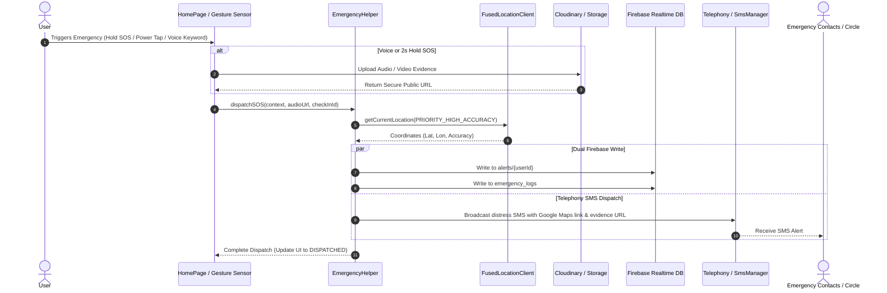

# 📘 WoShield — Deep Technical Specification & Architecture Manual

## 1. Executive Technical Summary
WoShield is an enterprise-grade Android safety platform built to provide non-downgrading, multi-modal distress detection and family coordination. This document outlines the internal state machines, reactive event pipelines, foreground service lifecycles, and cryptographic evidence mechanisms powering the application.

---

## 2. Component Architecture & Class Dictionary

### 2.1 Intelligence & Decision Systems
- **`SafetyIntelligenceEngine.java`**: Pure Java deterministic rules evaluator implementing a non-downgrading emergency hierarchy.
  - `RULE_EXPLICIT_SOS`: Maximum priority; cannot be downgraded or delayed.
  - `RULE_MISSED_CHECKIN`: Escalates if smart check-in timer expires without response.
  - `RULE_EXPLICIT_ASSISTANCE`: Virtual escort (`WalkWithMe`) notification active.
  - `RULE_STALE_LOCATION`: Handles GPS disconnection or stale readings gracefully without raising false alarms.
  - `RULE_POOR_ACCURACY`: Prevents corridor alerts when GPS accuracy radius exceeds maximum allowed deviation.
  - `RULE_DESTINATION_REACHED`: Terminates monitoring upon arrival at destination.
  - `RULE_SUSTAINED_DEVIATION`: Flags corridor departure only when sustained over $N$ consecutive reading samples, with deduplication.
  - `RULE_UNEXPECTED_DELAY`: Triggers when trip elapsed time exceeds ETA plus grace period.
- **`SafetyContext.java`**: Encapsulates device movement state, coordinates, speed, route proximity, and emergency flags.
- **`SafetyDecision.java`**: Structured outcome object containing decision ID, timestamp, outcome, triggering rule, signals list, and explainability string.
- **`SafetyRuleConfig.java`**: Configurable thresholds (accuracy limits, grace periods, deduplication windows).
- **`SafetyDecisionRepository.java`**: Firebase persistence layer for user safety decisions.

### 2.2 Acoustic Threat Detection & Audio Pipeline
- **`SurakshaService.java`**: Android 14 compliant Foreground Service with `foregroundServiceType="microphone"`. Runs `SpeechRecognizer` in continuous loop mode.
- **`SurakshaVoiceAI.java`**: 4-Tier keyword classification engine matching emergency, assault, abduction, and domestic abuse phrases.
- **`CloudinaryHelper.java`**: MediaManager wrapper configured for multipart audio upload, returning immutable HTTPS media URLs for SMS and Firebase dispatch.

### 2.3 Hardware Gestures & Panic Escalation
- **`PowerButtonService.java`**: Broadcast receiver listening to `Intent.ACTION_SCREEN_OFF`. Maintains atomic tap counter with 1-second timeout window. Detects 3 quick taps to trigger silent background video recording.
- **`VideoRecordingService.java`**: Silent background video recorder utilizing `MediaRecorder` with Camera & Audio sources. Auto-records 10 seconds of high-compression MP4 video and uploads to Firebase Cloud Storage under `evidence/{timestamp}.mp4`.
- **`ShakeDetector.java`**: SensorEventListener monitoring accelerometer $X, Y, Z$ vectors. Calculates aggregate acceleration force and debounces triggers.
- **`BuzzerTimerService.java`**: Foreground Service holding a `PowerManager.WakeLock`. Manages high-precision emergency countdowns. Plays looping siren (`siren.wav`) using `MediaPlayer` upon timeout and invokes `EmergencyHelper`.
- **`BuzzerAlarmReceiver.java`**: `BroadcastReceiver` receiving exact alarms from `AlarmManager` for countdown synchronization.

### 2.4 Smart Check-In & Routines
- **`CheckInRepository.java`**: Atomic state-transition repository operating on `Users/{uid}/checkIns/{checkInId}`. Enforces valid state transitions:
  $$\text{PENDING} \longrightarrow \text{CONFIRMED\_SAFE} \mid \text{ASSISTANCE\_REQUESTED} \mid \text{MISSED} \mid \text{SOS\_TRIGGERED}$$
- **`CheckInScheduler.java`**: Schedules exact `AlarmManager` wakeup intents with `FLAG_IMMUTABLE`.
- **`CheckInDeadlineReceiver.java`**: Evaluates elapsed deadlines and invokes `EmergencyHelper.dispatchSOS` if the user is unreachable.
- **`RoutineRepository.java`**: Handles storage of recurring transit profiles (departure times, waypoints, destinations, and assigned safe stops).

### 2.5 Sovereign Family Circles & Privacy
- **`FamilyCircleRepository.java`**: Consent-based invitation protocol. Handles invitation tokens, accepted wards, and realtime location observation.
- **`CirclePermissions.java`**: Per-guardian permission flags:
  - `canViewStatus`
  - `canViewLocation`
  - `canViewJourney`
  - `canReceiveSos`
  - `canReceiveAssistance`
  - `canReceiveMissedCheckIns`
  - `canReceiveRoutineUpdates`
  - `expiresAt` (TTL expiration support)
- **`PrivacyRepository.java`**: Manages temporary location-sharing sessions (`SharingSession.java`), logs user audit activity (`PrivacyActivityLog.java`), and handles cache clearing.

---

## 3. Emergency SOS State Machine & Escalation Sequence



---

## 4. REST & Cloud Integration Contracts

### 4.1 SambaNova AI Companion (Llama 3.1)
- **Endpoint**: `POST https://api.sambanova.ai/v1/chat/completions`
- **Headers**:
  - `Authorization`: `Bearer {API_KEY}`
  - `Content-Type`: `application/json`
- **Request Payload**:
  ```json
  {
    "model": "Meta-Llama-3.1-8B-Instruct",
    "messages": [
      {
        "role": "user",
        "content": "I feel like someone is following me on a dark street. What should I do?"
      }
    ],
    "stream": false
  }
  ```
- **Response**:
  ```json
  {
    "choices": [
      {
        "message": {
          "role": "assistant",
          "content": "1. Head immediately towards a lit, public area...\n2. Call a friend or use WoShield Walk-With-Me...\n3. If in immediate danger, trigger the SOS buzzer."
        }
      }
    ]
  }
  ```

---

## 5. Security & Cryptographic Principles
1. **Zero Unsolicited Location Leakage**: Location updates are only published to `LiveLocations/{uid}` if an active `SharingSession` exists or an active emergency SOS has been dispatched.
2. **Atomic Transitions**: Check-in states are governed via Firebase transactions (`runTransaction`) to prevent double-confirmations or racing background timeouts.
3. **Hardened Credentials**: API keys can be externalized to `local.properties` or environment variables for CI/CD builds.
